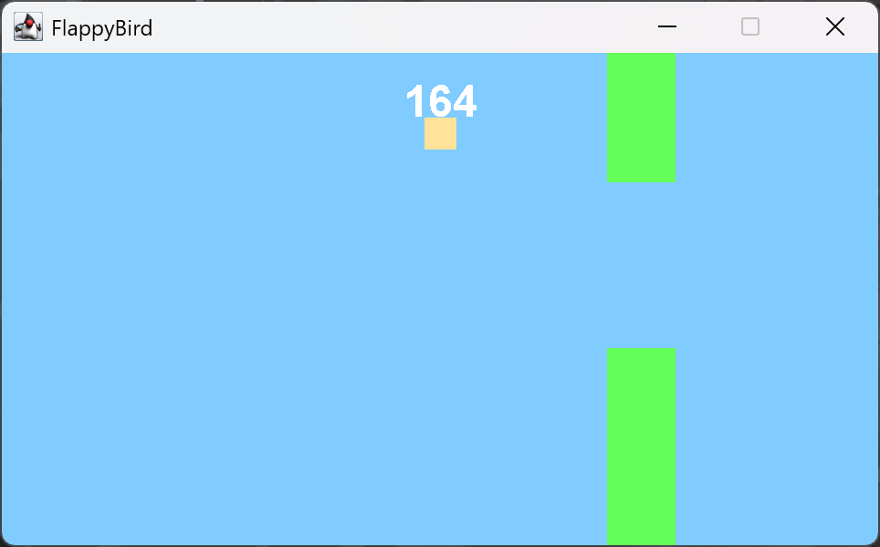

<div align="center">

# 🎮 JGame Library Lite

**A lightweight 2D game library for Java — think PyGame, but in Java.**

Pure Java · Zero dependencies · Runs anywhere Swing runs

[](https://openjdk.org/)
[](LICENSE)
[](https://raymond-weng.github.io/JGame-Library-Lite/Doc/index.html)
[](https://github.com/Raymond-Weng/JGame-Library-Lite)

[Quick Start](#-quick-start) · [Tutorial (EN)](Tutorial.md) · [教學 (中文)](教學.md) · [Javadoc](https://raymond-weng.github.io/JGame-Library-Lite/Doc/index.html)



<sub>The Flappy-Bird-style example game in <code>src/main/java/exampleCode</code></sub>

</div>

---

## ✨ Features

| | |
|---|---|
| 🖥️ **Cross-platform window** | Built on `JFrame`, so it runs on Windows, macOS and Linux |
| 🔁 **Game loop built in** | Separate update and render loops with configurable UPS / FPS |
| 🧩 **Game objects with layers** | Extend `GameObject`, add it to one of 10 priority layers (0–9) |
| 🖼️ **Image rendering** | Draw anything into an `Image` — shapes, sprites, text |
| 💥 **Hitboxes** | Rectangle and circle shapes, multi-hitboxes, and a `HitboxTracker` |
| 🎥 **Cameras** | Fixed, following and mouse-scrollable cameras |
| ⌨️ **Input** | Keyboard and mouse listeners ready to use |
| ⏱️ **Timers** | Run actions at a fixed rate on the game thread |
| 🐞 **Debug mode** | On-screen panel with FPS/UPS, hitbox overlay, and your own watched variables |
| 🔧 **Customizable** | Swap in your own `Output`, `Render`, `Update` or `Camera` implementation |

## 🚀 Quick Start

### Requirements

- **JDK 24** or newer

### Run the example game

```bash
git clone https://github.com/Raymond-Weng/JGame-Library-Lite.git
cd JGame-Library-Lite
javac -d out $(find src/main/java -name "*.java")
java -cp out exampleCode.Main
```

Press **Space** to jump. 🐤

### Use it in your own project

Copy `src/main/java/jGame` into your project's source folder, then:

```java
import jGame.core.*;
import jGame.loop.render.cameras.CameraImpl;
import jGame.loop.render.renders.RenderImpl;
import jGame.loop.update.updaters.UpdateImpl;
import jGame.main.Game;
import jGame.output.Frame;

import javax.swing.JFrame;

public class MyGame {
    public static void main(String[] args) {
        // 1. Create a window
        Frame frame = new Frame.Builder()
                .setFrameTitle("My Game")
                .setSize(new Size(960, 540))
                .setDefaultCloseOperation(JFrame.EXIT_ON_CLOSE)
                .build();

        // 2. Set up the camera and loops (60 FPS / 60 UPS)
        CameraImpl camera = new CameraImpl(new Position(0, 0), frame.getSize());
        RenderImpl render = new RenderImpl(60);
        UpdateImpl update = new UpdateImpl(60);

        // 3. Build the game
        Game game = new Game.Builder()
                .setOutput(frame)
                .setCamera(camera)
                .setRender(render)
                .setUpdate(update)
                .setDebug(true)
                .build();

        frame.setGame(game);
        camera.setGame(game);
        render.setGame(game);
        update.setGame(game);
        frame.showFrame();

        game.build();

        // 4. Add your objects (layer 0–9)
        game.addObject(new MyPlayer(), 5);

        // 5. Go!
        game.run();
    }
}
```

### Make a game object

```java
public class MyPlayer extends GameObject {
    private Position position = new Position(0, 0);

    @Override public void update()          { position = position.add(new Vector(1, 0)); }
    @Override public Image render()         { return SPRITE; }
    @Override public Position getPosition() { return position; }
    @Override public Hitbox getHitbox()     { return new Hitbox<>(new Rectangle(position, new Size(32, 32))); }
    @Override public Size getSize()         { return new Size(32, 32); }
}
```

👉 For the full walkthrough, see the **[Tutorial](Tutorial.md)** / **[教學](教學.md)**.

## 📦 Project Structure

```
src/main/java
├── jGame/                 # The library
│   ├── core/              # Position, Size, Vector
│   ├── main/              # Game and its Builder
│   ├── gameObject/        # GameObject + hitboxes (Rectangle, Circle, MultiHitbox)
│   ├── loop/
│   │   ├── render/        # Render loop and cameras
│   │   ├── update/        # Update loop
│   │   └── timer/         # Timers and game thread
│   ├── input/             # Keyboard and mouse listeners
│   ├── output/            # Frame (window) and loading screen
│   ├── debug/             # Debug panel and monitors
│   └── exception/
├── jGame3D/               # 3D extension (work in progress)
└── exampleCode/           # Flappy-Bird-style example game
```

## 🐞 Debug Mode

Turn it on with `.setDebug(true)` and watch any value live on screen:

```java
game.getDebugPanel().addVariable("Player Y",
        _ -> String.valueOf(player.getPosition().getIntY()));
```

## 🔗 Related

- **[3D-Game](https://github.com/Raymond-Weng/3D-Game)** — 3D plugin for this library *(in development)*

## 🤝 Contributing

Bug reports and pull requests are welcome! Please open an [issue](https://github.com/Raymond-Weng/JGame-Library-Lite/issues) first for bigger changes.

## 📄 License

Released under the [MIT License](LICENSE) © 2023 Raymond.
